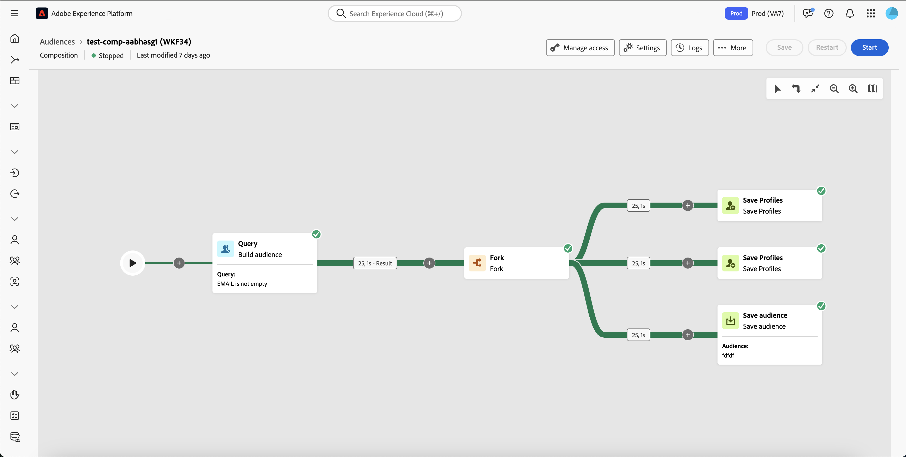
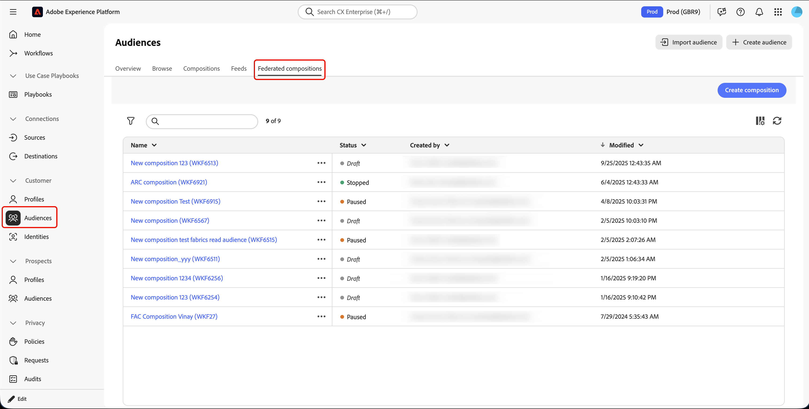
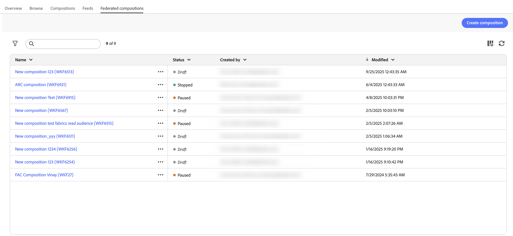
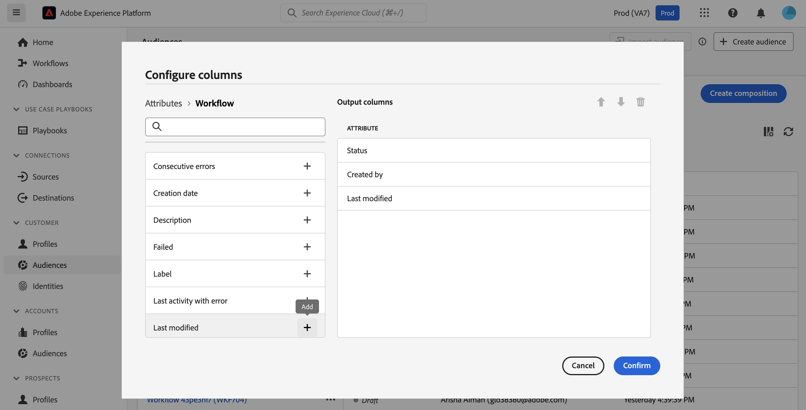
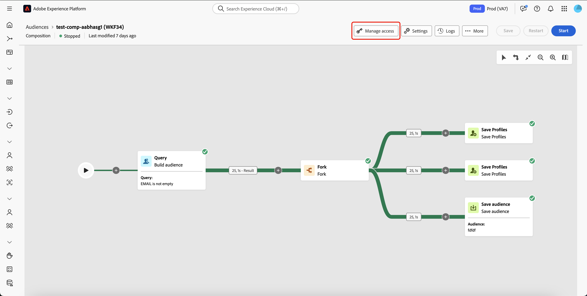
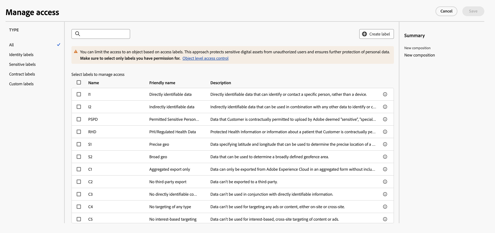

# 構成の概要

>[!AVAILABILITY]
>
>構成にアクセスするには、次のいずれかの権限が必要です。
>
>-**連合構成の管理**
>-**連合構成の表示**
>
>必要な権限について詳しくは、[アクセス制御ガイド](/help/governance-privacy-security/access-control.md)を参照してください。

連合オーディエンス構成では、構成を作成し、そこから視覚的なキャンバスで様々なアクティビティを活用してオーディエンスを作成できます。 構成を作成した後、結果として生成されたオーディエンスは Adobe Experience Platform に保存され、Experience Platform の宛先や Adobe Journey Optimizer で顧客のターゲティングに活用できます。

{zoomable="yes"}{width="70%"}

## 構成コンポーネント {#components}

連合オーディエンス構成内の構成は、次の部分で構成されます。

- **[!UICONTROL アクティビティ]**：アクティビティは実行されるタスクで、構成内にアイコンで表されます。
- **[!UICONTROL トランジション]**：トランジションは、ソースアクティビティを宛先アクティビティにリンクし、そのシーケンスを定義します。 トランジションに含まれる情報は、作業用テーブル内に保存されます。 各構成は、複数のワークテーブルを使用します。 これらのテーブルで伝えられるデータは、構成のライフサイクルを通じて使用できます。

## 構成へのアクセスと管理 {#access}

>[!CONTEXTUALHELP]
>id="dc_composition_list"
>title="構成"
>abstract="この画面では、構成の一覧全体にアクセスし、現在のステータス、前回／次回の実行日を確認して、新しい構成を作成できます。"

構成には、Adobe Experience Platform **[!UICONTROL オーディエンス]**&#x200B;メニューの「**[!UICONTROL 顧客]**」セクションにある「**[!UICONTROL 連合構成]**」タブからアクセスできます。

{zoomable="yes"}{width="70%"}

この画面から、構成に関する情報を表示したり、新しい構成を作成したりできます。

{zoomable="yes"}{width="70%"}

| フィールド | 説明 |
| ----- | ----------- |
| **[!UICONTROL 名前]** | 構成の名前。構成を選択すると、構成を編集できます。構成の作成と編集について詳しくは、[構成の作成ガイド](/help/compositions/create-composition.md)を参照してください。 |
| **[!UICONTROL ステータス]** | 構成のステータス。指定できる値には、[!UICONTROL ドラフト]、[!UICONTROL 処理中]、[!UICONTROL 停止]、[!UICONTROL 一時停止]、および[!UICONTROL エラー]があります。<ul><li>**[!UICONTROL ドラフト]**：構成が作成され、保存されました。</li><li>**[!UICONTROL 処理中]**：構成が実行され、現在実行中です。</li><li>**[!UICONTROL 停止]**：構成の実行が完了し、停止しました。</li><li>**[!UICONTROL 一時停止]**：構成の実行が一時停止されました。</li><li>**[!UICONTROL エラー]**：構成の実行でエラーが発生しました。エラーに関する詳細情報を表示するには、構成を開き、ログにアクセスします。</li></ul>構成を開始または停止する方法については、[構成の作成ガイド](./create-composition.md#monitor-logs)を参照してください。 |
| **[!UICONTROL 作成者]** | 構成を作成した人の名前とメールアドレス。 |
| **[!UICONTROL 変更日]** | 構成が最後に更新された日付と時刻。 |

また、名前の横にある「」ボタンを選択して、構成に対してクイックアクションを実行することもできます。

| アクション | 説明 |
| ------ | ----------- |
| **[!UICONTROL 複製]** | 選択した構成を複製します。 |
| **[!UICONTROL 削除]** | 選択した構成を削除します。 |
| **[!UICONTROL パッケージに追加]** | サンドボックス間で構成を移動します。この機能について詳しくは、[サンドボックスツールガイド](https://experienceleague.adobe.com/ja/docs/experience-platform/sandbox/ui/sandbox-tooling)を参照してください。 |

リストを絞り込み、探している構成を見つけるには、リストを検索し、ステータスまたは最終処理日で構成をフィルタリングします。

また、列を追加または削除してリストをカスタマイズすることもできます。 これを行うには、「**[!UICONTROL 列を設定]**」ボタンを選択し、目的の出力列を追加または削除します。

{zoomable="yes"}{width="70%"}

### アクセスラベルの適用 {#access-labels}

特定の構成にアクセスラベルを適用するには、構成、「**[!UICONTROL アクセスを管理]**」の順に選択します。

{zoomable="yes"}{width="70%"}

**[!UICONTROL アクセスを管理]**&#x200B;ポップオーバーが表示されます。 このページでは、該当するアクセスラベルとデータガバナンスラベルを構成に適用できます。

{zoomable="yes"}{width="70%"}

| ラベルタイプ | 説明 |
| ---------- | ----------- |
| 契約ラベル | 契約ラベル（「C」ラベル）は、契約上の義務を負うデータや、組織のデータガバナンスポリシーに関連するデータの分類に使用されます。 |
| ID ラベル | ID ラベル（「I」ラベル）は、個人を特定できるデータや、個人に連絡できるデータの分類に使用されます。 |
| 機密ラベル | 機密ラベル（「S」ラベル）は、ユーザーや組織が機密性が高いと見なすデータの分類に使用されます。 |
| パートナーエコシステムラベル | パートナーエコシステムラベルは、組織の外部のソースからのデータの分類に使用されます。 |

アクセスラベルとデータガバナンスラベルについて詳しくは、[データ使用ラベル用語集](https://experienceleague.adobe.com/ja/docs/experience-platform/data-governance/labels/reference)を参照してください。

## 作成 {#create}

オーディエンス構成を使用して、Adobe Experience Platform の構成を作成できます。 詳しくは、[構成の作成ガイド](./create-composition.md)を参照してください。

## 次の手順

このガイドを参照することで、構成のアクセスラベルにアクセスし、管理し、作成する方法を学びました。 オーディエンス全体の操作方法について詳しくは、[オーディエンスガイド](../start/audiences.md)を参照してください。
